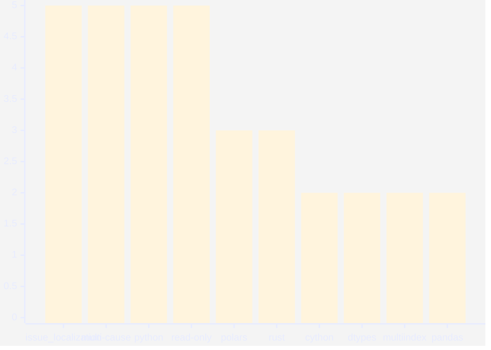
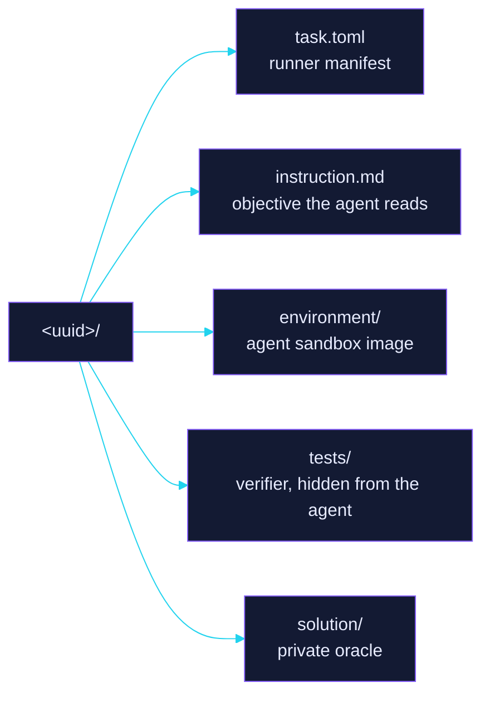

# mirage: samples

<b>The mirage samples lane: 5 of 30 Harbor task bundles.</b>

  

<a href="#research-paper">Research paper</a> | <a href="#research-problem-statement">Research problem statement</a> | <a href="#research-experimentation-design">Research experimentation design</a> | <a href="#task-overview">Task overview</a> | <a href="#harbor-format-walkthrough">Harbor format walkthrough</a> | <a href="#contact">Contact</a>

## Research paper

_Not yet written._

## Research problem statement

_Not yet written._

## Research experimentation design

_Not yet written._

## Task overview

The public sample of this corpus: at most 30 Harbor task bundles, anchors first, then in seal order.

Each bundle is one Harbor task in a directory named by its content-derived uuid5, so the name doubles as an integrity check. This page is rendered from the resident bundles on every reconcile; a value a bundle does not carry reads `absent`, and the page never fills one in.

| Property | Value |
| --- | --- |
| Bundles | 5 of 30 |
| Sealed | 0 of 5 |
| Registrations | unregistered (5) |
| Audit verdicts | none (5) |
| Harbor schema | 1.4 (5) |

Pass rates are measured by the trials recorded in each bundle, not by a signed pilot, and no tier is claimed.

| Bundle | Model | Trials | Successes | pass@1 | pass@5 |
| --- | --- | --- | --- | --- | --- |
| 00e686b1-9a02-5c13-9c3a-fa5824129971 | not yet measured | - | - | - | - |
| 0d205e9a-9537-5ba9-817a-1132725ee409 | not yet measured | - | - | - | - |
| 6ffc6d6d-0988-58ef-8129-c72093f48bf5 | not yet measured | - | - | - | - |
| 78de1d0b-9e9d-584d-aeea-b34efee7cc2a | not yet measured | - | - | - | - |
| d5a207d9-6e08-5c5c-99c1-e0f8e306b11d | not yet measured | - | - | - | - |

The verdict is the audit outcome recorded at the sealed digest, and `none` means no verdict has landed for that digest yet. Only an authoring run removes a bundle from this lane, so removal waits for the next one.

| uuid | Verdict | Sealed digest | Stream |
| --- | --- | --- | --- |
| 00e686b1-9a02-5c13-9c3a-fa5824129971 | none | absent | none |
| 0d205e9a-9537-5ba9-817a-1132725ee409 | none | absent | none |
| 6ffc6d6d-0988-58ef-8129-c72093f48bf5 | none | absent | none |
| 78de1d0b-9e9d-584d-aeea-b34efee7cc2a | none | absent | none |
| d5a207d9-6e08-5c5c-99c1-e0f8e306b11d | none | absent | none |

| Keyword | Bundles |
| --- | --- |
| issue_localization | 5 |
| multi-cause | 5 |
| python | 5 |
| read-only | 5 |
| polars | 3 |
| rust | 3 |
| cython | 2 |
| dtypes | 2 |
| multiindex | 2 |
| pandas | 2 |
| casting | 1 |
| copy-on-write | 1 |
| groupby | 1 |
| joins | 1 |
| query-optimizer | 1 |
| reshape | 1 |
| sorted-flag | 1 |
| sql | 1 |

| Bundle | Task | Keywords | Registration | Sealed at |
| --- | --- | --- | --- | --- |
| [`00e686b1-9a02-5c13-9c3a-fa5824129971`](00e686b1-9a02-5c13-9c3a-fa5824129971/) | `mirage/00e686b1-9a02-5c13-9c3a-fa5824129971` | copy-on-write, cython, groupby, issue_localization, multi-cause, multiindex, pandas, python, read-only | unregistered | unsealed |
| [`0d205e9a-9537-5ba9-817a-1132725ee409`](0d205e9a-9537-5ba9-817a-1132725ee409/) | `mirage/0d205e9a-9537-5ba9-817a-1132725ee409` | issue_localization, multi-cause, polars, python, read-only, rust, sorted-flag | unregistered | unsealed |
| [`6ffc6d6d-0988-58ef-8129-c72093f48bf5`](6ffc6d6d-0988-58ef-8129-c72093f48bf5/) | `mirage/6ffc6d6d-0988-58ef-8129-c72093f48bf5` | cython, dtypes, issue_localization, multi-cause, multiindex, pandas, python, read-only, reshape | unregistered | unsealed |
| [`78de1d0b-9e9d-584d-aeea-b34efee7cc2a`](78de1d0b-9e9d-584d-aeea-b34efee7cc2a/) | `mirage/78de1d0b-9e9d-584d-aeea-b34efee7cc2a` | casting, dtypes, issue_localization, joins, multi-cause, polars, python, read-only, rust | unregistered | unsealed |
| [`d5a207d9-6e08-5c5c-99c1-e0f8e306b11d`](d5a207d9-6e08-5c5c-99c1-e0f8e306b11d/) | `mirage/d5a207d9-6e08-5c5c-99c1-e0f8e306b11d` | issue_localization, multi-cause, polars, python, query-optimizer, read-only, rust, sql | unregistered | unsealed |

## Harbor format walkthrough

| Entry | Role |
| --- | --- |
| `task.toml` | runner manifest |
| `instruction.md` | objective the agent reads |
| `environment/` | agent sandbox image |
| `tests/` | verifier, hidden from the agent |
| `solution/` | private oracle |

1. `task.toml` declares the schema, the metadata, the agent, and the environment.
2. `instruction.md` is what the agent reads.
3. `environment/` builds the sandbox the agent works in.
4. `tests/` grades the result.
5. `solution/` is the private oracle.
6. Run one bundle with Harbor against its directory: `harbor run -p <bundle> -a <agent> -e docker`.

Each bundle directory is a complete Harbor task: `task.toml` is the runner manifest, `instruction.md` the objective, `environment/` the sandbox image, and `tests/` the verifier. Point a Harbor runner at one bundle directory to reproduce it; `solution/` stays private.

## Contact

[research@ethara.ai](mailto:research@ethara.ai)

Copyright (c) 2026 Green Rider Technology LLP (Ethara AI). All rights reserved.
